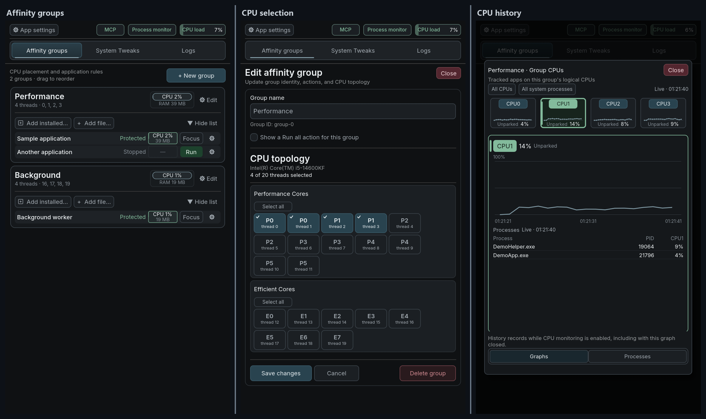
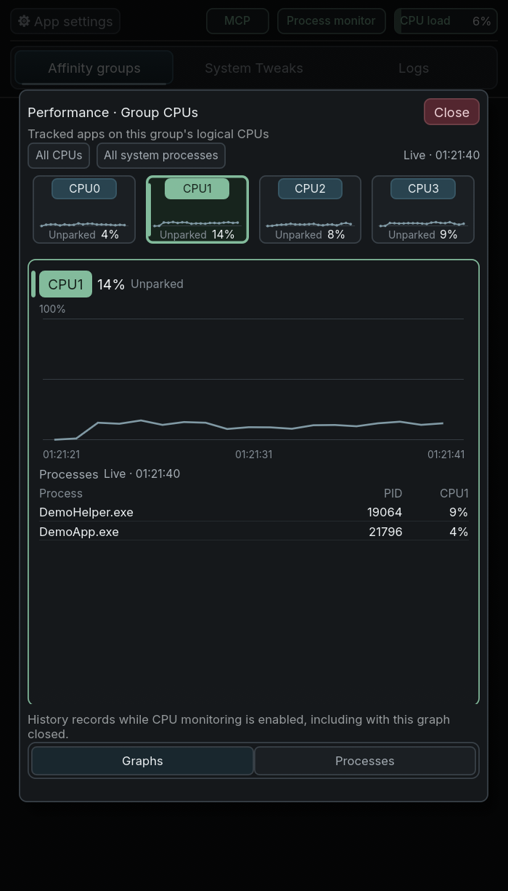
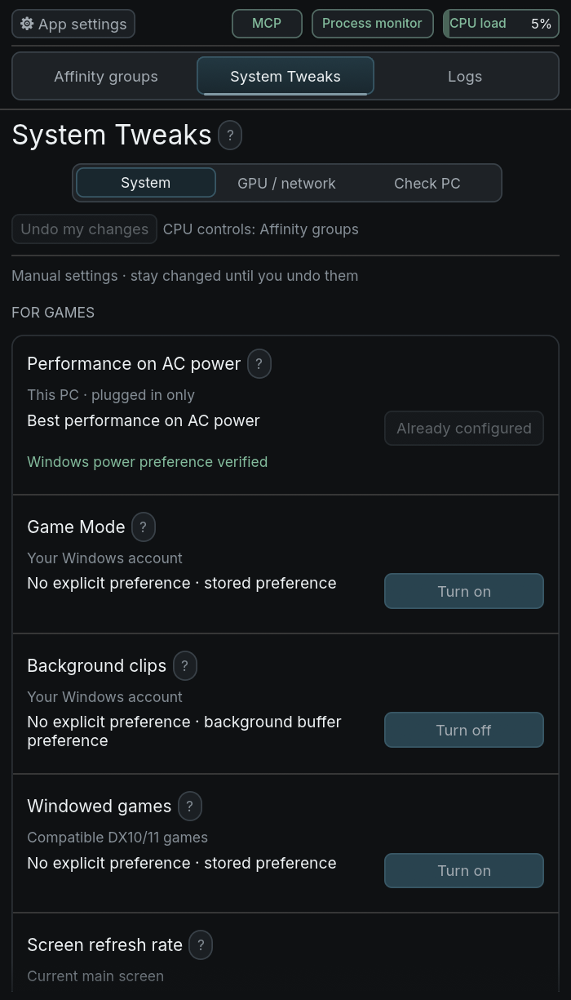

# CPU Affinity Tool

Save CPU affinity and priority rules for Windows applications. Organize apps into CPU groups, launch them with the settings you chose, and keep those settings applied while they run.

Set up a game and its background apps once, instead of repeating the changes in Task Manager after every launch. Inspect CPU history, adjust selected Windows settings, or connect a local agent to manage the same setup.

**[Download for Windows](https://github.com/middaysan/cpu-affinity-tool/releases/latest)** · [Getting started](#getting-started) · [MCP guide](docs/mcp.md) · [Documentation](#documentation)

**New in [1.7.0](https://github.com/middaysan/cpu-affinity-tool/releases/tag/v1.7.0):** CPU/process history with PNG and CSV export, System Tweaks, and optional local AI-agent control through MCP.



*Affinity groups and the CPU selection screen, shown side by side. CPU selections depend on your processor. [Light theme](assets/screenshots/main-light.png).*

## Getting started

1. Download `cpu-affinity-tool.exe` from the [Windows release](https://github.com/middaysan/cpu-affinity-tool/releases/latest) and run it from a stable folder. Windows asks for administrator approval.
2. Choose **New group**, name the group, and select its logical CPUs.
3. Use **Add installed...**, **Add file...**, or drag and drop to add an application. Save its launch and tracking settings.
4. Select **Run**. Open **Process monitor** and keep **Enable process monitor** checked if you want ongoing affinity and priority corrections.
5. Open **CPU load** to check recording and choose the history duration. Click a group or application load meter to open **Graphs / Processes**.

Both monitors start enabled for new configurations; existing saved preferences are preserved.

Upgrading keeps your saved groups and application rules. If an older configuration has no **CPU load** preference, recording starts enabled with a 5-minute history. **MCP** starts off, and System Tweaks applies changes only when you request them.

**App settings** contains the System / Light / Dark theme selector and **Start minimized**. Start minimized opens the next launch in the tray; it does not register the tool to start at Windows sign-in.

Performance depends on the application and workload. Compare CPU activity and responsiveness before keeping a new configuration. [How affinity helps and where it has limits](docs/why.md) · [Comparison with other tools](docs/comparison.md).

## What you can do

### Keep a repeatable process setup

- Create groups of logical CPUs for foreground work, background apps, or a particular workload.
- Add executables, supported launcher files, or installed apps. Drag and drop from Explorer also works.
- Save priority, startup behavior, and extra process names, plus launch arguments for file-based targets. Name suggestions come from running processes.
- Use **Process monitor** to find your saved apps and reapply their affinity and priority. Its **Processes** and **Logs** tabs show what it found and changed.
- Reorder groups and apps, launch a group together, or create a Windows desktop shortcut for a saved rule.

Child-process management is an explicit per-rule option and starts off for new rules. Protected or inaccessible processes may refuse changes; failures appear in **Logs**.

### See where CPU time goes

**CPU load** records CPU and process activity independently of Process monitor. Recording continues with graphs closed or the app in the tray. History stays in RAM: choose 30 seconds, 5 minutes (default), or 30 minutes.

Open a system, group, or application graph to inspect individual logical CPUs, their sampled parking state, and the processes contributing at a selected time. Group graphs start with your tracked apps; **All system processes** expands the scope. The **Processes** tab has sortable columns.



*Actual recorded activity, captured during 1.7.0 development. The example workload is generated by a local test process.*

Right-click a graph to save the visible chart as **PNG** or export all retained CPU/process history as **CSV**. A connected agent can download the same history through MCP. Turning recording off releases the retained history.

[View the process table](assets/screenshots/processes.png) · [View the export menu](assets/screenshots/history-export.png)

### Change individual Windows settings

**System Tweaks** brings together selected Windows controls: AC power mode, Game Mode, background clips, windowed-game settings, display refresh rate, per-app GPU preference, accessibility shortcuts, and mouse acceleration. Hardware and network guidance and an optional read-only PC check are alongside them.



*Current settings are read from Windows. No tweaks were applied to take this screenshot.*

Manual changes remain applied after you close the app. **Undo** uses the recorded original values and preserves later changes made elsewhere. Display changes have a confirmation countdown. See the [System Tweaks guide](docs/system-tweaks.md) for what each control changes.

**Development preview:** this branch adds one optional per-app background-load reduction checkbox in Application rule settings. It requests priority/EcoQoS only, with no manual core selection. System roles remain unchanged while their controlled VM validation is pending; the native CPU mechanisms have been checked only on owned test processes. This is not part of the published 1.7.0 release. [Preview controls and limits](docs/background-workload.md).

### Connect a local agent

The Windows EXE includes an optional **localhost Streamable HTTP MCP server**, disabled by default. Open **MCP**, enable it, then choose **Copy AI prompt** for setup instructions or **Copy connection** for manual configuration.

An agent can manage groups and rules, change monitoring settings, launch programs, inspect exact process instances, read bounded program output and logs, use System Tweaks, and download CPU history. The MCP window keeps a readable journal of the last 100 commands.

**One permanent key gives full access to the supported tools. Share it only with an agent you trust.** Ordinary-user launch is the default for agent-started programs; administrator launch is explicit. No separate server executable is needed.

[Connection window](assets/screenshots/mcp-connection.png) · [Setup and API guide](docs/mcp.md)

## Platforms and data

- **Windows x64** is the stable release platform. The current renderer uses DirectX 12, and the release requires administrator approval. Saved-rule shortcuts may show the same UAC prompt.
- **Linux** has a separate desktop beta for x86_64 glibc, with X11/Wayland sessions and [beta prereleases](https://github.com/middaysan/cpu-affinity-tool/releases). CPU recording, System Tweaks and production MCP are Windows-only; Linux does not have full Windows feature parity. macOS is unsupported.
- New Windows configurations use `%LOCALAPPDATA%\CpuAffinityTool\state.json`. An existing `state.json` beside the EXE keeps its legacy location. **Logs → Data folder** opens the active directory.
- Version 1.7.0 saves configuration as schema v11. Keep a backup before upgrading; loading an older format alone does not rewrite it, but an explicit save upgrades it. Downgrading after a current-format save is unsupported.
- Logs and available crash reports stay local and are not uploaded automatically. Review them before sharing. CPU history is retained in memory and saved to a file only when you export it.

## Build from source

Use **Rust 1.95 or newer**. Windows builds need the MSVC C++ build tools and Windows SDK.

```powershell
# Windows production EXE and matching debug symbols
pwsh -NoProfile -File scripts/build-windows-release.ps1
```

The executable is written to `target/release/cpu-affinity-tool.exe`.

```sh
# Linux desktop beta
cargo run --features linux --bin cpu-affinity-tool-linux
```

See [CONTRIBUTING.md](CONTRIBUTING.md) for dependencies and validation commands, and the [release process](docs/release-process.md) for packaging.

## Documentation

- [Troubleshooting, data locations, shortcuts and crash reports](SUPPORT.md)
- [Local agent setup and MCP API](docs/mcp.md)
- [System Tweaks controls and Undo](docs/system-tweaks.md)
- [Affinity: uses and limits](docs/why.md) · [Tool comparison](docs/comparison.md)
- [Release notes](CHANGELOG.md) · [Reported issues](https://github.com/middaysan/cpu-affinity-tool/issues)
- [Contributing](CONTRIBUTING.md) · [Private security reporting](SECURITY.md)

[MIT license](LICENSE). The interface uses [Inter](assets/fonts/README.md), distributed under the [SIL Open Font License](assets/fonts/LICENSE.txt).
